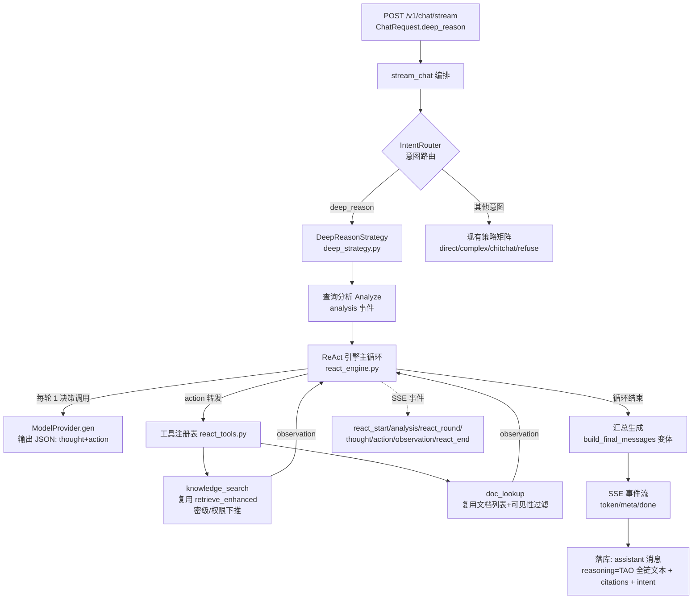

# 企业公文知识库 · 深度推理问答模块（ReAct Agent）设计与实现方案 V1.0

> 状态：**V1.1 已按用户评审反馈重构完成**（2026-10-16；用户实测后指出 6 个问题，全部为架构级，逐条落实见 §0）
> 提出时间：2026-10-16
> 关联文档：《详细功能设计文档》《详细设计文档 V1.2》《Agent 意图路由与分步执行方案 V1.1》
> 需求原文（用户 2026-10-16）：新增深度推理问答模块——ReAct Agent 动态循环（查询分析 → Thought/Action/Observation 循环 → 迭代决策与停止 → 最终生成），完整推理思维链通过 SSE 友好展示。

---

## 0. V1.1 重构说明（用户评审反馈 → 逐条落实）

用户实际体验后指出 6 个问题，全部为**架构级**，已逐条重构并用真实模型验证：

| # | 用户反馈 | 根因 | V1.1 改法 |
|---|---|---|---|
| 1 | 页面完全没有思维链体现 | `ReActTracePanel` 渲染在**消息列表之外**（列表与输入框之间），且 Thought 用 `white-space: nowrap` 单行省略——长思维链视觉上等于不存在 | 面板**内联到消息流**答案上方；TAO 段落全部改完整多行、零截断；命中明细展开显示标题+摘要全文 |
| 2 | 问题分析/推理循环/工具调用过程没体现 | 旧版只在 `single_hop=false` 时才渲染"查询分析"块，单跳问题整块隐藏 | 理解阶段**始终展示**：诉求复述、模型自述是否查库、候选方向、待澄清点 |
| 3 | 还是一上来就开始检索，和之前一条链路没区别 | ① `ANALYZE_SYSTEM` 有 `single_hop`（"单跳直接检索"降级短路）；② `_run_react` 零引用时**无条件兜底再检索一次**；③ 工具只有 2 个且不能看原文 | **删除 single_hop 与全部降级分支**；删除强制兜底检索；新增 `read_document`（模型自主打开原文核对条款）；是否检索/用哪个工具/何时收尾**全部由模型逐轮自主决定** |
| 4 | 提示词管理不可见 | 无暴露接口 | 新增 `GET /v1/chat/react/prompts` + 前端「提示词」抽屉：四阶段提示词全文 + 工具契约，所见即所跑 |
| 5 | 不支持多轮上下文 | ReAct 决策历史只有 `req.query`，**完全不含会话历史** | `run_react` 新增 `history` 参数，会话历史注入决策上下文（指代消解前提） |
| 6 | 无材料就拒答，但用户要的是完成任务 | `_run_react` 零引用 → 固定话术拒答 | **删除拒答路径**：零材料也进最终生成（切"通用知识兜底"分支并标注依据不足），末尾统一附「AI 生成，请人工鉴别」 |

实测对照（真实 Qwen3，非 mock）：

| 场景 | 结果 |
|---|---|
| 通用常识（"公文标题怎么拟"） | 模型自述 `needs_knowledge=false` → **第 1 轮直接 finish，零工具调用**，5.4s / 1123 字完整答案（自动标注"知识库暂无对应规定"） |
| 查库问题 | 5 轮自主决策：`knowledge_search` → `read_document`（打开原文）→ `knowledge_search` → `doc_lookup`，13 条引用，26s |
| 多轮追问（"它的适用范围是什么"） | 模型思考中明确引用上一轮结论完成指代消解 → 正常作答 1013 字 |

---

## 1. 需求理解与目标

### 1.1 需求拆解（必须逐项落地的能力）

| # | 需求点 | 本方案落点 |
|---|---|---|
| 1 | 查询分析：判断是否需要拆解为多个子问题 | §5.3 提问理解阶段（**V1.1 重构**：只让模型复述诉求并自述是否查库，不做任何路由，见 §0） |
| 2 | ReAct 推理循环：Thought → Action → Observation 动态迭代 | §5.4 ReAct 引擎主循环 |
| 3 | 工具调用：核心为知识库检索工具（`rag_retrieve_tool`），预留数据库/网络扩展 | §5.5 工具协议与注册表 |
| 4 | 迭代决策与停止：信息充足退出 / 不足继续 / 换关键词重试 | §5.4 停止条件与护栏 |
| 5 | 最终生成：综合多轮信息、交叉验证、按来源权威性排序 | §5.7 汇总生成 |
| 6 | 完整推理思维链，SSE 友好展示 | §5.8 SSE 事件协议 + §6 前端 TAO 时间线 |

### 1.2 设计目标（验收口径）

1. **多跳问题**（对比、多条件、排查根因、跨文档综合）回答质量显著优于单轮检索——以评测台指标验收（§7），不以感觉验收；
2. 思维链**完整可见、可回看、可审计**（每轮思考/行动/观察结构化展示并落库）；
3. **安全红线不破**：检索工具内部复用现有密级/权限 WHERE 下推，不新增任何数据通路；
4. **可用性红线不破**：任何环节失败都降级到现有"单轮检索 + 直答"，用户的问题永远不失败（§5.10）；
5. 延迟与成本**显式可控**：轮数上限 + 全局预算 + 实时进度可见。

---

## 2. 与现有智能问答的区别

| 维度 | 现有 direct_qa（单轮检索直答） | 现有 complex_task（分步执行） | **本模块 deep_reason（ReAct）** |
|---|---|---|---|
| 检索次数与时机 | 1 次，query 原样 | 1 次拆步后**按计划**每步 1 次，计划一次定死 | **动态 N 轮**，每轮检索什么由"上一轮观察 + 当前思考"决定 |
| 思考链 | 模型隐式 `reasoning_content`，不可控、不作为决策依据、不展示流程 | 无独立思考链；步骤是规则模板/LLM 一次性拆出的 | **显式结构化 Thought**（模型每轮自主输出），前端逐轮展示，落库可回看 |
| 工具 | 无工具概念，代码直接调 `retrieve_enhanced` | 代码内置 retrieve/generate 两动作 | **工具注册表**：`knowledge_search` / `doc_lookup`，模型自选 |
| 停止条件 | 无（一次到底） | 计划步骤执行完 | 模型自评充足主动 `finish` / 轮数上限 / 预算耗尽 / 连续无进展 / 解析失败 |
| 多跳/对比问题能力 | 弱（单查询召回受 query 稀释） | 中（固定三模板：对比/汇总/排查） | **强**：可逐步收窄、换角度重检、分别检索对比双方 |
| 引用 | 单轮 top-N | 按步骤合并去重（≤8） | 逐轮聚合并重排序（≤N，按相关度+来源权威） |
| 延迟 / token 成本 | 低 | 中 | **高**（多轮 LLM 决策 + 多轮检索，数秒~数十秒；prompt 逐轮累积） |
| 失败模式 | 无材料拒答 | 步骤失败仍汇总 | 需护栏防"死循环/重复检索"（§5.4），且整体可降级 |

一句话：**现有问答是"单次管道 + 固定剧本"，本模块是"模型自主决策的多轮搜索循环 + 透明思维链"**。

---

## 3. 优点与缺点

### 3.1 优点

1. **多跳问题覆盖率与正确率提升**："A 和 B 的差异"可分别检索 A、B 再比对；"排查类"可先查现象、再查处置规范，逐步逼近答案，不受单次 query 语义稀释影响；
2. **过程透明、可信、可审计**：思维链逐轮可见，用户能回答"这个结论是怎么来的"，配合引用编号可核对，是**显式抑制幻觉的机制**（而非事后声明）；
3. **按需检索**：信息够了立即停，避免"一次塞 8 条"的上下文稀释；信息不足才追加检索，检索质量由模型反馈闭环驱动；
4. **工具可扩展**：新增工具（如文档元数据查询）只需注册，主循环零改动；
5. **复用存量资产**：检索（RRF+rerank+改写+父块注入+权限下推）、生成、脱敏、审计、会话落库全部复用，不造新引擎；
6. **体验差异化**：SSE 逐轮推送让长推理"有来有回"，用户感知从"卡住等答案"变为"看 Agent 工作"。

### 3.2 缺点与缓解措施

| 缺点 | 影响 | 缓解措施 |
|---|---|---|
| **延迟高**：每轮 1 次 LLM 决策调用 + 1 次检索（含 rerank ~6.5s），3 轮即数十秒 | 体验风险 | 实时进度 SSE；硬预算（默认总 120s 可配）；提供"停止"随时中断；简单问题可配置走普通问答 |
| **token 成本高**：observations 逐轮累积注入 prompt | 32B-INT4 上下文压力 | 观测截断（snippet ≤160 字、命中 ≤5 条/轮、历史轮摘要化）；轮数上限；累计引用上限 |
| **模型决策可能退化**（重复检索同一 query、格式不合法、过早 finish） | 质量问题 | JSON 宽容解析 + 连续 2 次解析失败退出；query 去重跳过；连续 2 轮无新命中强制收敛；few-shot 约束 |
| **实现复杂度高**：状态机、护栏、SSE 事件面扩大 | 维护成本 | 引擎纯函数化（输入状态→输出事件），可单测；失败路径全部预案化 |
| **模型规模依赖**：32B-INT4 决策质量优于小模型但仍需 prompt 工程 | 效果风险 | 决策调用低温度（0.1~0.2）+ few-shot；评测台按问题集回归（§7） |
| **会话与历史的语义边界**（历史轮 vs 本轮循环） | 复杂度 | 循环 only 针对本轮 query；会话历史仍按现有机制注入最终生成阶段 |

---

## 4. 总体架构

### 4.1 架构图



### 4.2 复用清单（明确"不造新轮子"）

| 能力 | 复用现有 | 说明 |
|---|---|---|
| 混合检索（RRF+rerank+改写+父块注入+权限下推） | `retrieval.retrieve_enhanced` | 工具的 `knowledge_search` 就是对它的一层薄封装 |
| 无材料双信号判定 | `agent.policies.is_no_useful_info` | observation 质量信号、最终无材料拒答判定 |
| 直答 / 分步策略 | `chat._run_direct_answer` 等 | 降级目标 |
| 提示词模板 / 检索配置 / Agent 配置 | `runtime_config` | 新增 `load_react_config`，同模式（改库即生效） |
| 流式生成 | `ModelProvider.generate_stream` | 最终答案流式 |
| 脱敏 / 审计 / 会话落库 / 停止语义 | `chat.py` 统一收尾 | 本策略只写 ctx 状态，不改收尾骨架 |
| 前端容器 | Chat.vue 结构（sidebar + 消息流 + 输入区） | 新视图 DeepQa.vue 照搬结构 + 新 TAO 面板 |

### 4.3 新增文件清单

| 文件 | 职责 |
|---|---|
| `backend/app/services/agent/react_engine.py` | ReAct 主循环（状态机 + 护栏 + SSE 事件产出），异步生成器 |
| `backend/app/services/agent/react_tools.py` | 工具注册表 + `knowledge_search` / `doc_lookup` 实现 |
| `backend/app/services/agent/react_prompt.py` | 决策 prompt（system + few-shot）、观测注入、最终生成 prompt |
| `backend/app/services/agent/react_config.py` | `ReactConfig` dataclass + `load_react_config(db)`（并入 runtime_config 亦可，独立更清晰） |
| `backend/app/services/chat.py`（改） | 新增 `_run_react` 策略；`_CHAT_STRATEGIES["deep_reason"]` 注册一行 |
| `backend/app/services/agent/intents.py`（改） | 注册 `deep_reason` 意图规格 |
| `backend/app/schemas/contracts.py`（改） | `ChatRequest.deep_reason: bool \| None` |
| `backend/app/services/model_provider.py`（改） | `generate/generate_stream` 增加 `extra_body` 透传（`chat_template_kwargs.enable_thinking=False` 用） |
| `backend/alembic/versions/0016_*.py`（新） | seed 深度推理配置项默认值（与 0008/0009 同模式） |
| `frontend/src/views/DeepQa.vue`（新） | 深度问答页 |
| `frontend/src/components/ReActTracePanel.vue`（新） | TAO 时间线组件 |
| `frontend/src/api/client.ts`（改） | `streamChat` handlers 扩展 7 个新事件 |
| `frontend/src/router.ts` + 侧边导航（改） | 注册 `/deep-qa` 路由与入口 |
| `backend/tests/test_react_engine.py` 等（新） | §7 测试 |

---

## 5. 后端详细设计

### 5.1 请求契约扩展

```python
class ChatRequest(BaseModel):
    ...
    # 深度推理问答（None=跟随配置中心 deep_reason_enabled；显式 true/false 覆盖）
    deep_reason: bool | None = None
```

- 请求级 > 配置中心（与 `agent_mode` / `rerank` 现有语义一致）；
- `deep_reason` 生效条件：`deep_reason_resolved AND intent in {direct_qa, complex_task}`——**闲聊/超范围/公文起草意图不受影响**（后者走 `/v1/generate`）。

路由判定（`stream_chat` 内，意图识别之后）：

```
deep_on = req.deep_reason if req.deep_reason is not None else react_cfg.enabled
if deep_on and intent in ("direct_qa", "complex_task"):
    strategy = _run_react
```

### 5.2 配置中心（category=agent，新迁移 0016 seed）

| key | 默认 | 说明 |
|---|---|---|
| `deep_reason_enabled` | `false` | 总开关。**默认关**，页面开关/请求级可开；上线前评测达标再议默认值 |
| `deep_max_rounds` | `4` | 单轮问答最大 TAO 循环轮数（含首轮） |
| `deep_total_budget_ms` | `120000` | 全局硬预算（含分析/各轮决策/检索/最终生成） |
| `deep_decision_timeout_ms` | `20000` | 单轮决策调用超时 |
| `deep_retrieve_top_n` | `6` | 每轮检索召回条数 |
| `deep_obs_hits` | `5` | 每轮注入 prompt 的命中条数上限 |
| `deep_obs_snippet_chars` | `160` | 观测 snippet 截断 |
| `deep_max_citations` | `12` | 最终引用上限 |
| `deep_temperature` | `0.2` | 决策调用温度 |
| `deep_source_priority` | `""` | 来源文种优先级（如 `决定,意见,通知,通报,报告`；空=按相关度） |

### 5.3 查询分析（Analyze）

一次轻量 LLM 调用（temperature=0，max_tokens=256，超时 10s），输出 JSON：

```json
{"single_hop": false,
 "sub_questions": ["A 产品 华东区 销售额", "B 产品 华东区 销售额"],
 "reason": "涉及两个实体的对比，需分别检索"}
```

- `single_hop=true`：首轮直接用原 query 检索（不预拆，拆解交给循环自然完成）；
- `single_hop=false`：**分析事件推送子问题给前端展示**，但循环第一轮**仍从原 query 或第一个子问题起步**（预拆清单仅作"意图提示"与展示，不锁死执行顺序——保持 ReAct 动态性）；
- 分析调用失败/超时/不可解析：静默降级 `single_hop=true`，推送 analysis 事件注明"未能预分析，将动态推理"。

### 5.4 ReAct 引擎主循环

#### 5.4.1 循环体（单轮）

```
每轮 round (1..max_rounds):
  1. 预算检查: 已耗时 > total_budget → stop_reason="budget"，跳出
  2. 决策调用: messages=[system, ...history, observations] → gen.generate(JSON, max_tokens=512, extra_body=enable_thinking=False)
     - 超时/异常: decision_fail +=1
        decision_fail >= 2 → stop_reason="decision_fail"，跳出（进入 final，用已收集材料）
        decision_fail < 2  → 注入"上次决策失败，请重试"观察，继续
  3. 解析 JSON（宽容）:
     失败: parse_fail +=1；连续 2 次 → stop_reason="parse_fail"，跳出
  4. 产出 thought 事件；if action.tool == "finish" → stop_reason="final"，跳出
  5. 产出 action 事件；查工具注册表:
     未注册工具 → 观察"无此工具"，continue
  6. 执行工具(knowledge_search/doc_lookup) → 产出 observation 事件
     - 与历史 query 去重（归一化后完全相同）→ 观察标注"重复检索已跳过"，不调工具
     - 连续 2 轮空/无新引用 → 观察注入"已连续无新信息，请基于现有材料 finish"
  7. 新引用并入 ctx.citations（按 chunk_id 去重）
循环结束 → finalize(stop_reason)
```

#### 5.4.2 护栏总表（防退化）

| 护栏 | 触发 | 行为 |
|---|---|---|
| 轮数上限 | `round > max_rounds` | 退出循环，finalize("max_rounds") |
| 全局预算 | 累计耗时 > `deep_total_budget_ms` | 退出，finalize("budget") |
| 决策失败容忍 | 决策调用异常/超时 | 首次注入重试提示；连续 2 次退出 |
| 解析失败容忍 | JSON 不可解析 | 连续 2 次退出 |
| query 去重 | 与历史检索 query 归一化相同 | 跳过真实工具调用，观察标注跳过 |
| 无进展收敛 | 连续 2 轮无新引用 | 观察注入收敛提示，引导 finish |
| 工具白名单 | action.tool 不在注册表 | 观察"无此工具"，不执行 |

#### 5.4.3 停止原因语义（透出前端 + 落库）

`final`（模型主动）/ `max_rounds` / `budget` / `parse_fail` / `decision_fail` / `no_progress`。

### 5.5 工具协议

#### 5.5.1 工具注册表

| 工具 | 入参 | 实现 | 说明 |
|---|---|---|---|
| `knowledge_search` | `{"query": "..."}` | `retrieve_enhanced`（top_n=`deep_retrieve_top_n`） | 核心。**内部已完成密级/权限/空间下推** |
| `doc_lookup` | `{"title"/"doc_no"/"doc_type"/"space_id" 可选组合}` | 复用 `list_documents` 链路（同名可见性过滤） | 元数据级查询（"有没有关于 X 的文件"），仅返文档摘要，不返正文 |

> **网络搜索工具：本版本不提供**——私有化内网部署禁出网（涉密红线）。工具协议抽象已预留，未来如有合规的"内部站点检索"可注册即用。
> **任意数据库查询工具：不提供**——直连 SQL 有越权风险；结构化查询需求由 `doc_lookup` 覆盖。

#### 5.5.2 决策输出协议（模型每轮唯一输出）

```json
{"thought": "已知…，尚缺…，因为…所以下一步…",
 "action": {"tool": "knowledge_search", "query": "具体的子问题"}}
{"thought": "材料已覆盖问题，可交叉验证作答",
 "action": {"tool": "finish", "query": ""}}
```

- 宽容解析：截取第一个 `{...}`；`action`/`thought` 字段缺失/类型不符 → parse_fail；
- `query` 归一化用于去重（去空白、统一标点、小写）。

#### 5.5.3 Observation 结构（注入 prompt + SSE 推送同源）

```json
{"type": "observation", "round": 2, "tool": "knowledge_search",
 "query": "A产品华东区销售额",
 "hits": [{"n": 1, "title": "…", "doc_no": "…", "snippet": "…≤160字", "score": 0.62}],
 "quality": {"top_vector_distance": 0.31, "keyword_hits": 3, "rerank_top1": 0.72},
 "note": ""}
```

- `note` 承载：空结果 / 重复跳过 / 无新信息 / 工具异常 / 连续无进展提示；
- 质量信号帮助模型（与人）判断"这轮检得行不行"。

### 5.6 Prompt 设计（决策调用）

**system prompt（草稿，随评测迭代）**：

```
你是企业公文知识库的「深度推理问答」智能体，通过多轮调用工具收集证据，最后给出有依据的回答。
每一轮你只能输出一个 JSON 对象，不得输出任何其他文字，两种形态：
1) 继续检索：{"thought": "…", "action": {"tool": "knowledge_search", "query": "具体子问题"}}
2) 结束作答：{"thought": "…", "action": {"tool": "finish", "query": ""}}
可用工具：knowledge_search（知识库语义+关键词混合检索）、doc_lookup（按标题/文号查文件）。
规则：
1. thought 先总结已知、再指出缺口、最后说明下一步为什么；
2. query 要具体、可检索，一次只查一个点；对比/多实体问题分别检索；
3. 观察为空或不相关时，换关键词或换角度重试；
4. 事实性结论必须引用观察中的材料编号 [n]；材料未覆盖的注明"依据不足"，不得编造；
5. 信息足够就 finish，不要为问而问；最多 {max_rounds} 轮。
```

**messages 组装**（每轮）：

```
system: 如上
assistant: 第 k 轮决策 JSON
user: "[观察 k] tool=… query=… 命中 n 条：…"（结构化文本块）
```

**预算控制**：历史轮观察摘要化（保留 thought + 命中标题列表 + note，snippet 仅保留最近 1 轮完整版），观测注入上限按 §5.2 配置执行。

### 5.7 最终生成（Finalize）

1. 引用聚合：`ctx.citations` 按 chunk_id 去重，按**相关度降序**（无 rerank 分则 RRF 分）；`deep_source_priority` 非空时同分按文种优先级排序；截断至 `deep_max_citations` 并**全局重编号 [1..N]**；
2. 构造最终 messages（复用 `build_final_messages` 的同类结构，增加"多轮检索综合/交叉验证"指令）：
   - "以下材料来自多轮检索，可能存在过时或相互矛盾的表述；**相互矛盾的条款须并列指出并说明以哪份为准（通常新规定/上级规定优先）**"；
   - "结论标注引用 [n]"；
   - 注入会话 history（多轮追问语境）；
3. 无材料分支：`ctx.citations` 为空 → `is_no_useful_info` 判定 → direct_qa 同款固定话术**委婉拒答**（deep_reason 是确切回答型，`allows_self_capability=False`，不编造）；
4. 流式产出（`generate_stream`）+ meta（含最终引用）/ token / done。

### 5.8 SSE 事件协议（新增 7 类事件，向后兼容）

| 事件 | 载荷 | 前端行为 |
|---|---|---|
| `react_start` | `{mode:"react", max_rounds, total_budget_ms, tools:["knowledge_search","doc_lookup"]}` | 初始化 TAO 面板，显示轮数上限与预算 |
| `analysis` | `{single_hop, sub_questions[], reason}` | 查询分析卡（子问题 chips） |
| `react_round` | `{round, max_rounds}` | 时间线新增"第 N 轮"容器（运行中呼吸点） |
| `thought` | `{round, text}` | 轮内 💭 Thought 渲染（可打字机效果） |
| `action` | `{round, tool, query, skipped?}` | 轮内 ⚡ Action 徽标 + query |
| `observation` | `{round, tool, query, hits[], quality{}, note}` | 轮内 📄 命中文档 chips + 质量点；note 高亮 |
| `react_end` | `{rounds, stop_reason, citations_total}` | 时间线收尾条（停止原因中文映射） |

> 老客户端忽略未知 type，完全兼容；最终答案仍走既有 `meta/token/done`。

### 5.9 权限与密级（红线，逐条对应）

1. 工具 `knowledge_search` = `retrieve_enhanced` → `build_visibility_filter` 下推 + `space_ids` + `max_clearance`（调用方额度已在入口 `cap_clearance`）；
2. `doc_lookup` 复用 `visible_space_ids` + 空间可写校验；
3. **观察内容即检索结果，天然不含越权数据**（查不到 = 观察为空）；
4. 最终落库/脱敏/审计完全复用 `chat.py` 收尾，零新增数据出口；
5. 审计 `record_audit`：意图识别行追加 `mode=react rounds=N stop_reason=… tools=[…]`。

### 5.10 降级与红线（任何一步失败，"用户的问题不失败"）

| 失败点 | 降级行为 |
|---|---|
| 查询分析失败 | 降级 single_hop，循环照常 |
| 决策调用连续 2 次失败/超时 | 用已收集材料（如有）直接 finalize；无材料 → 单轮检索兜底 |
| 决策 JSON 连续 2 次不可解析 | 同上 |
| 检索工具异常 | observation 记 error，模型可换角度；若一直异常 → 有旧材料则 finalize，无则兜底直答 |
| 全局预算耗尽 | finalize with 现有材料 |
| 策略整体异常 | `chat.py` 既有 except → error 事件 + 已生成部分保留 |
| 深度开关异常/配置缺失 | 回落现有策略矩阵 |

### 5.11 落库与会话

- assistant 消息 `reasoning` = **格式化 TAO 全链文本**：
  ```
  【查询分析】单跳=否；子问题：A/B…
  【第1轮】思考：… → 行动：knowledge_search("…") → 观察：命中3条（《…》…）
  【第2轮】… → finish（停止原因：信息充分）
  ```
- `citations` = 最终全局引用；`intent = "deep_reason"`；`sensitive_hits/model` 同现有；
- **不改消息表结构**（无迁移），历史消息打开即回看完整思维链（折叠面板）。

---

## 6. 前端详细设计

### 6.1 页面与路由

- 新视图 `frontend/src/views/DeepQa.vue`，路由 `/deep-qa`，侧边导航入口"深度问答"（与"智能问答/智能起草"并列，图标可区分：🧠 或循环图标）；
- 结构复用 Chat.vue：左 ConversationSidebar（`conv_type='chat'`，与普通问答**共用会话列表与历史**——同一会话里两种模式产生的消息都在，消息按 intent 徽标区分）+ 右消息流 + 输入区；
- 顶栏"深度推理"开关（默认按配置中心 `deep_reason_enabled`，会话内持久到 localStorage）。

### 6.2 页面状态机

| 状态 | 进入条件 | UI 呈现 |
|---|---|---|
| `idle` 空态 | 无消息且未发送 | 欢迎语 + 示例问题（对比/排查类）+ "展示完整推理思维链"说明 |
| `analyzing` | 发送后、收到 react_start/analysis 前 | 查询分析卡（骨架动画） |
| `looping` | 收到 analysis 后、react_end 前 | TAO 时间线逐轮追加；当前轮呼吸点；输入区变"停止" |
| `generating` | react_end 后 | 时间线折叠为各轮摘要（可展开）；正文流式 + 光标 |
| `done` | done 事件 | 完整答案（Markdown）+ 引用 tags + 停止原因条 + TAO 时间线全览 |
| `error` | error 事件/abort | 错误条 + 已落库部分刷新可见 |

### 6.3 TAO 时间线组件 `ReActTracePanel.vue`

```
┌─ Agent 执行过程 · 深度推理 ──────────── 第 2/4 轮 ●live ─┐
│ 【查询分析】子问题：A产品华东区销售额 / B产品华东区销售额    │
│ ┌ 第 1 轮 ────────────────────────────────────────────┐  │
│ │ 💭 思考：需要分别检索 A、B 的销售额才能对比…（可展开）  │  │
│ │ ⚡ 行动：knowledge_search —— "A 产品华东区销售额"      │  │
│ │ 📄 命中 3 条：《…》(0.62)《…》(0.55) [相关度色点]      │  │
│ └──────────────────────────────────────────────────────┘  │
│ ┌ 第 2 轮（运行中）…                                       │
│ └──────────────────────────────────────────────────────┘  │
│ ▸ 结束：信息充分（共 2 轮，累计引用 5 条）                  │
└────────────────────────────────────────────────────────────┘
```

- 交互：Thought/Observation 默认溢出折叠、点击展开；命中文档 chip 悬停显 snippet；观测质量点（向量距离/keyword/rerank top1）小问号提示；
- 复用设计令牌与 AgentStepPanel 样式语言（同 `--brand` 体系），保持三端一致。

### 6.4 client.ts 扩展

```ts
export interface ChatHandlers {
  ...
  onReactStart?: (info: { max_rounds: number; total_budget_ms: number; tools: string[] }) => void
  onAnalysis?: (a: { single_hop: boolean; sub_questions: string[]; reason: string }) => void
  onReactRound?: (round: number, max_rounds: number) => void
  onThought?: (round: number, text: string) => void
  onAction?: (round: number, tool: string, query: string, skipped?: boolean) => void
  onObservation?: (round: number, o: { tool: string; query: string; hits: any[]; quality: any; note: string }) => void
  onReactEnd?: (info: { rounds: number; stop_reason: string; citations_total: number }) => void
}
```

### 6.5 历史回看

会话详情返回的 assistant 消息含 `reasoning`（TAO 全链文本）→ `ReasoningPanel` 组件已支持"默认折叠、可展开"；深度消息用 `ReActTracePanel(static)` 从 reasoning 文本**结构化回放**（后端同时以固定前缀格式落库，前端解析 `【第N轮】…` 行还原时间线——约定格式见 §5.11，解析失败回落纯文本展示）。

---

## 7. 测试方案

| 层 | 用例 | 验收 |
|---|---|---|
| 单测 | JSON 宽容解析（前后夹杂文字/字段缺失/大小写） | 合法输入 100% 解析，非法全部走 parse_fail 计数 |
| 单测 | 护栏：max_rounds / budget / 去重 / 连续无进展 / 连续解析失败 | 每护栏有事件序断言，循环必然收敛（不悬空） |
| 单测 | 引用聚合并重排序、全局重编号、上限截断 | 去重正确、无空洞编号 |
| 单测 | 降级：决策失败→兜底；工具异常→观察 error | 不抛异常，产出兜底答案 |
| 集成 | Mock ModelProvider 驱动 3 轮（search→search→finish）+ Mock 检索 | SSE 事件序：react_start→analysis→(round/thought/action/observation)×2→react_end→meta→token→done；citations 合并；reasoning 落库含 3 轮 |
| 集成 | 无材料场景 → 拒答固定话术，no_result=true | 不调最终生成 |
| 端到端 | curl `deep_reason=true` 真实模型 | 完整 trace、人工抽查思维链合理性 |
| 安全回归 | 运行既有 `test_migration_0015` / 所有权 / 密级测试 | 全绿（不破坏存量行为） |
| 评测（M4） | 多跳问题集（对比/多条件/排查 ≥30 题）指标：平均轮数、引用准确率、拒答正确率、P50/P95 延迟、对比普通问答的正确率提升 | 达标后议 `deep_reason_enabled` 默认值 |

---

## 8. 里程碑（每阶段有验证门禁）

| 阶段 | 内容 | 验证门禁 |
|---|---|---|
| **M1 最小链路** | 契约+配置+引擎骨架：analysis→1 轮 search→final；7 类 SSE；失败降级直答 | 集成测试 + curl 跑通"单跳"问题 |
| **M2 完整循环** | 多轮循环 + 全部护栏 + 预算 + 去重 + 观测质量信号 + 引用聚合/重编号 + doc_lookup | 护栏单测全绿；mock 3 轮集成绿 |
| **M3 前端** | DeepQa.vue + ReActTracePanel + client handlers + 持久化回看 + 停止中断 | `pnpm build` 通过；浏览器端到端人工验收 |
| **M4 评测与默认值** | 评测台 + 问题集回归 + prompt 迭代 + 配置默认值定版 | 指标达标；文档更新；单测+集成全绿 |

---

## 9. 关键决策（用户 2026-10-16 已确认并已实现）

| # | 议题 | 确认结论 | 落地情况 |
|---|---|---|---|
| 1 | 入口形态 | **独立页面 `/deep-qa`**（导航「深度问答」），与普通问答/起草并列；会话列表共用 | ✅ `views/DeepQa.vue` + 路由 + 导航项 |
| 2 | 默认开启策略 | **默认全开**：问答类意图（direct_qa / complex_task）一律被 deep_reason 接管；闲聊/拒答/起草不受影响；显式 `deep_reason=false` 完全回到旧链路 | ✅ `ReactConfig.enabled=True` + `stream_chat` 意图改写 |
| 3 | 工具集 | **两个工具**：`knowledge_search`（核心）+ `doc_lookup`（文件元数据查询）；网络搜索因禁出网不提供 | ✅ `react_tools.py` 工具注册表 |
| 4 | 轮数与延迟预算 | **双档位可选**：快速模式（2 轮 / 60s，默认档）与深度模式（5 轮 / 180s）；UI 一键切换，档位随请求 `react_mode` 传入 | ✅ `ReactConfig.for_mode()` + 前端单选切换 + localStorage 偏好 |
| 5 | 模型决策输出 | 决策调用透传 `chat_template_kwargs={"enable_thinking": False}`（关闭思考链保JSON 纯净）；不依赖 function-calling / tool-call-parser | ✅ `ModelProvider.generate(extra_body=...)` |
| 6 | 来源权威排序 | v1 按相关度（rerank/RRF 分）排序 + 全局重编号，暂不引入文种优先级 | ✅ `build_final_messages` |

### 已实现并实测的关键结论
- **决策调用必须拿到原始问题**（真实端到端踩坑：决策历史仅含system prompt 时，模型回「用户尚未提出具体问题」→ 0 引用直接 finish）。现首条 user 消息注入原始问题 + 分析出的子问题清单，并有单测锁死（`test_react_first_decision_sees_user_query`）。
- **兜底链有效**：循环零引用（决策连续失败 / 过早 finish）→ 自动单轮检索复检 → 仍无 → 委婉拒答，**问题永不失败**。

---

*里程碑 M1–M3 已交付并实测（2026-10-16）：后端 27 项ReAct 测试 + 全量 237 项pytest 全绿；前端 build 通过；真实模型端到端验证深度档 5 轮循环 / 快速档 2 轮 / 关闭档回退三态全部符合设计。M4 评测台与默认值标定待后续开展。*
